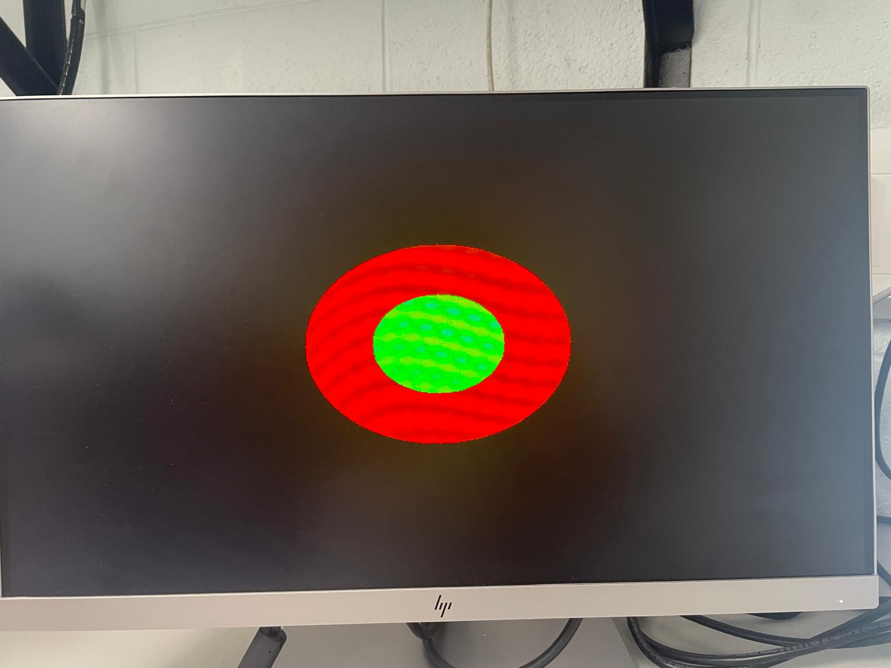
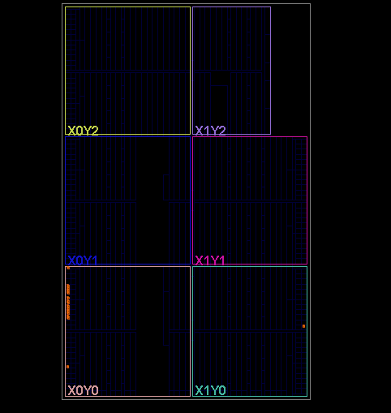
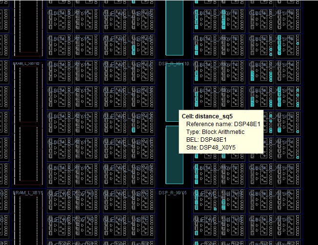

Add a short welcome message or introduction here. Aim to get the viewer interested in what follows! Guideline: 1 or 2 sentences. 
Hello this project is based on the Basys- 3 FPGA Board. I was able to create a VGA with template code of colorful stripes and a project I am currently designing.
I am adding a test sentence here at 13:24 on 03/12/24.

## **Template VGA Design**
19/10/2026
### **Project Set-Up**
Summarise the project set-up and design flow. Include a screenshot of your own set-up, for example see the image of my Project Summary window below. Guideline 1 short paragraph.

### **Template Code**
Outline the structure and design of the Verilog code templates you were given. What do they do? Include reference to how a VGA interface works. Guideline: 2/3 short paragraphs, consider including screenshot(s).

- The structure of the Verilog code contained each columns with the designated stripes of each color. Each were 80 pixels. I put the testbench and other files within the correct directory in Vivado for the code to execute properly. VGA works through a HDMI cable connected from the BASYS 3 chip directly to the 2nd display of computer. In Vivado, when Open Hardware Manager is run, I clicked Open Target and then Program Device. This connected the code through the chip back to the 2nd display.
### **Simulation**
Explain the simulation process. Reference any important details, include a well-selected screenshot of the simulation. Guideline: 1/2 short paragraphs.

The simulation has a lot of blue, red and green lines but overall the green seems pretty consistent. It shows that the code is working fine with a few errors for the red line and blue line for...

### **Synthesis**
Describe the synthesis and implementation processes. Consider including 1/2 useful screenshot(s). Guideline: 1/2 short paragraphs.
Synthesis shows what parts of the physical FPGA board is working. The cyan blocks which are also dsp blocks seen in this picture uses the formula dx*dx + dy*dy which makes up to formula of the circle.

### **Demonstration**
.
## **My VGA Design Edit**
Introduce your own design idea. Consider how complex/achievabble this might be or otherwise. Reference any research you do online (use hyperlinks).
For my VGA Design Edit I will be doing pink polka dots scattered/ in a pattern on a colored screen. This is a bit complex as I need to find the formula of a circle and integrate that into the code. I need to determine the number and colors of circles within the display, how to scatter them/have them in a pattern (most likely diagonally). I also need to solve any bugs while encountering this code. Research details:
### **Code Adaptation**
Briefly show how you changed the template code to display a different image. Demonstrate your understanding. Guideline: 1-2 short paragraphs.
I used the VGAColourCycleSourceCode template to make multiple pink polka dots across the screen. Although the file name is VGAColourStripes, this is where my adapted code lies. I changed the color of the dots from the template by making red_next   = 4'h0; and blue_next  = 4'h0; since this can change the color to pink and making  green_next = 4'h0; since green is not needed to make pink and for the black background, I made red_next   = 4'h0, green_next = 4'h0 and blue_next  = 4'h0.  knew I could change the size of the circle smaller or bigger by changing the distance between one point to the other in the circle so in the code I chose to put distance_sq <= 2500. I assigned multiple **signed wires**. On the 640 by 480 screen, I knew I could position the  to position each circle in the screen I changed dx = col - 320 and dy = row - 240 also while assigning the same formula dx1 * dx1 + dy1 * dy1 to each circle.
### **Simulation**
Show how you simulated your own design. Are there any things to note? Demonstrate your understanding. Add a screenshot. Guideline: 1-2 short paragraphs.
### **Synthesis**
Describe the synthesis & implementation outputs for your design, are there any differences to that of the original design? Guideline 1-2 short paragraphs.
### **Demonstration**
If you get your own design working on the Basys3 board, take a picture! Guideline: 1-2 sentences.

## **More Markdown Basics**
This is a paragraph. Add an empty line to start a new paragraph.

Font can be emphasised as *Italic* or **Bold**.

Code can be highlighted by using `backticks`.

Hyperlinks look like this: [GitHub Help](https://help.github.com/).

A bullet list can be rendered as follows:
- vectors
- algorithms
- iterators

Images can be added by uploading them to the repository in a /docs/assets/images folder, and then rendering using HTML via githubusercontent.com as shown in the example below.

