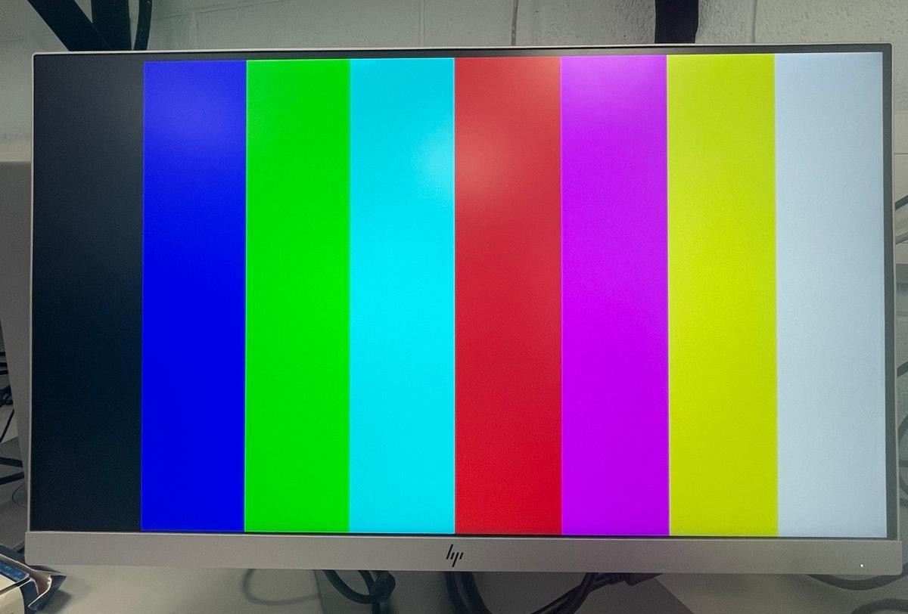
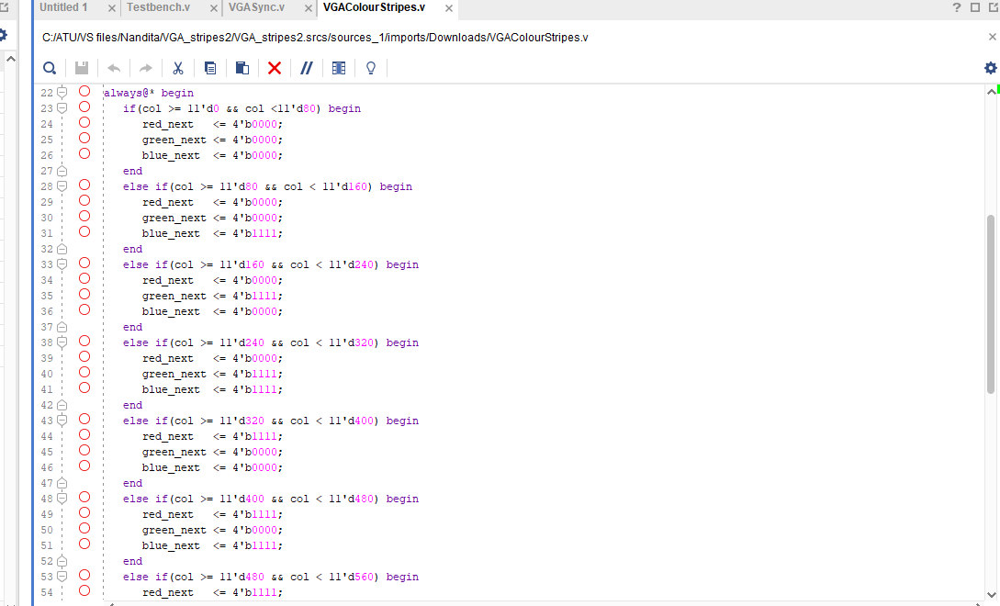
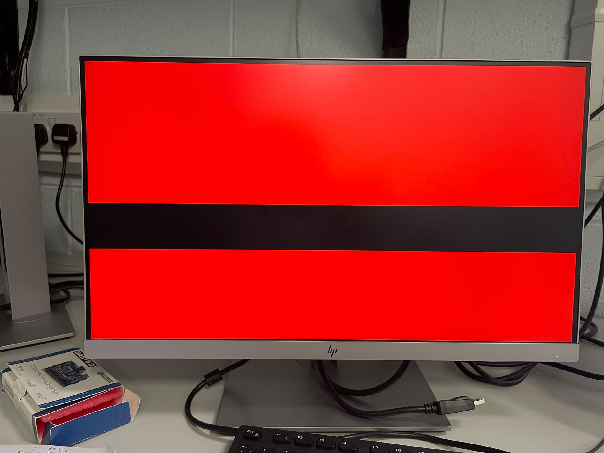
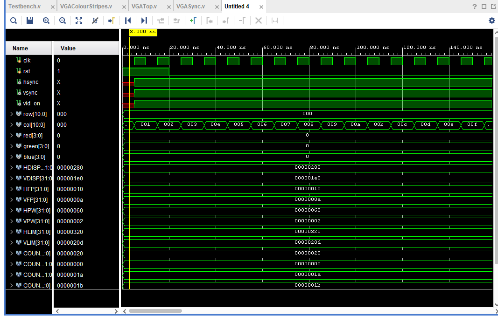
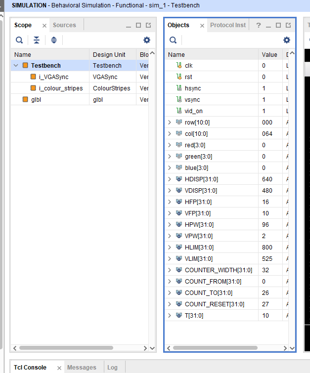
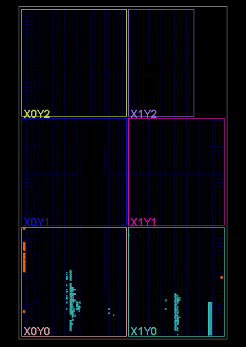
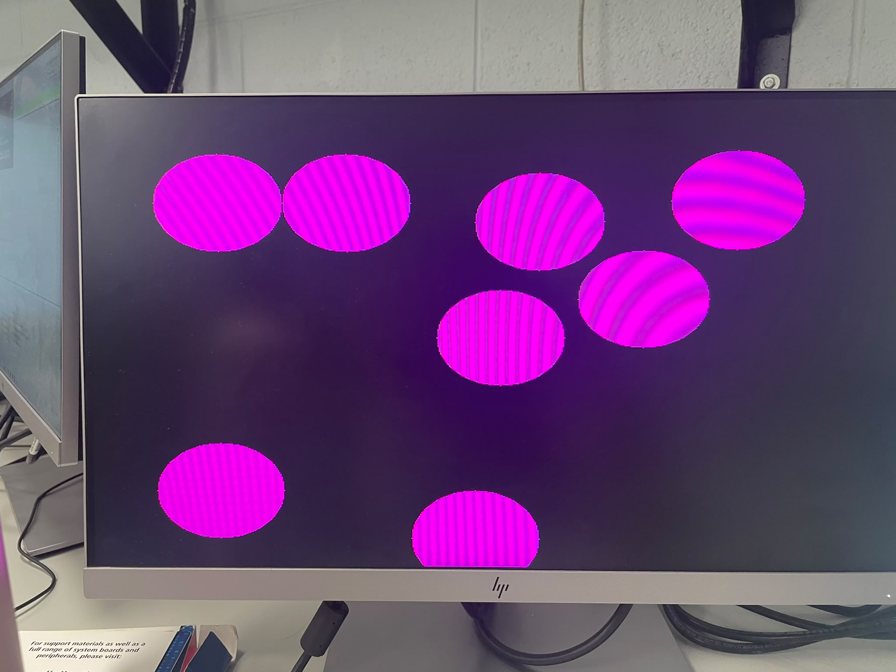

Hello, my name is Nandita and this project is based on the Basys- 3 FPGA Board. I was able to create 9 pink polka dots scattered across the screen with the help of the templates.

## **Template VGA Design**
19/10/2026
### **Project Set-Up**
Summarise the project set-up and design flow. Include a screenshot of your own set-up, for example see the image of my Project Summary window below. Guideline 1 short paragraph.

### **Template Code**
Outline the structure and design of the Verilog code templates you were given. What do they do? Include reference to how a VGA interface works. Guideline: 2/3 short paragraphs, consider including screenshot(s).

- The structure of the Verilog code contained each columns with the designated stripes of each color. Each were 80 pixels. I put the testbench and other files within the correct directory in Vivado for the code to execute properly. VGA works through a HDMI cable connected from the BASYS 3 chip directly to the 2nd display of computer. In Vivado, when Open Hardware Manager is run, I clicked Open Target and then Program Device. This connected the code through the chip back to the 2nd display.
### **Simulation**
Explain the simulation process. Reference any important details, include a well-selected screenshot of the simulation. Guideline: 1/2 short paragraphs.

The simulation has a lot of blue, red and green lines but overall the green seems pretty consistent. It shows that the code is working fine with a few errors for the red line and blue line for...

### **Synthesis**
Describe the synthesis and implementation processes. Consider including 1/2 useful screenshot(s). Guideline: 1/2 short paragraphs.
Synthesis shows what parts of the physical FPGA board is working. The cyan blocks which are also dsp blocks seen in this picture uses the formula dx*dx + dy*dy which makes up to formula of the circle.

### **Demonstration**

## **My VGA Design Edit**
Introduce your own design idea. Consider how complex/achievabble this might be or otherwise. Reference any research you do online (use hyperlinks).
For my VGA Design Edit I will be doing pink polka dots scattered/ in a pattern on a colored screen. This is a bit complex but achievable as I need to find the formula of a circle and integrate that into the code. I need to determine the number, size and colors of circles within the display and how to scatter them. I also need to solve any bugs with simulation, implementation, generating bitstream while also ensuring the hardware is connected properly. 
Research datails: Microsoft CoPilot(snip bits from to show where i got it from)
### **Code Adaptation**
Briefly show how you changed the template code to display a different image. Demonstrate your understanding. Guideline: 1-2 short paragraphs.
I used the VGAColourCycleSourceCode template to make multiple pink polka dots across the screen. Although the file name is VGAColourStripes, this is where my adapted code lies. I changed the color of the dots from the template by making `red_next   = 4'h0;` and `blue_next  = 4'h0;` since this can change the color to pink and making  `green_next = 4'h0;` since green is not needed to make pink and for the black background, I made red_next   = 4'h0, green_next = 4'h0 and blue_next  = 4'h0.  knew I could change the size of the circle smaller or bigger by changing the distance between one point to the other in the circle so in the code I chose to put `distance_sq <= 2500`. I assigned multiple **signed wires**. On the 640 by 480 screen, I knew I could position the  to position each circle in the screen I changed `dx = col - 320` and `dy = row - 240` also while assigning the same formula `dx1 * dx1 + dy1 * dy1` to each circle.

### **Simulation**
Show how you simulated your own design. Are there any things to note? Demonstrate your understanding. Add a screenshot. Guideline: 1-2 short paragraphs.
In Vivado, I clicked Simulation -> Run Simulation -> Run Behavioral simulation. This simulation uses the code in the testbench.v to show that the clock and reset is working. There is red showing in the beginning of the simulation, which means that...

### **Synthesis**
 The cyan blocks which are also dsp blocks seen in this picture uses the formula dx*dx + dy*dy which makes up to formula of the circle. DSP blocks take care of the multiplication and adding in the formula. 

Describe the synthesis & implementation outputs for your design, are there any differences to that of the original design? Guideline 1-2 short paragraphs.
### **Demonstration**
If you get your own design working on the Basys3 board, take a picture! Guideline: 1-2 sentences.
This picture shows the 9 polka dots scattered across the screen on a black background. I connected the board to the second display of the computer with a HDMI cable. A USB cable is connected to the board to power up the board

## **More Markdown Basics**
This is a paragraph. Add an empty line to start a new paragraph.

Font can be emphasised as *Italic* or **Bold**.

Code can be highlighted by using `backticks`.

Hyperlinks look like this: [GitHub Help](https://help.github.com/).

A bullet list can be rendered as follows:
- vectors
- algorithms
- iterators
